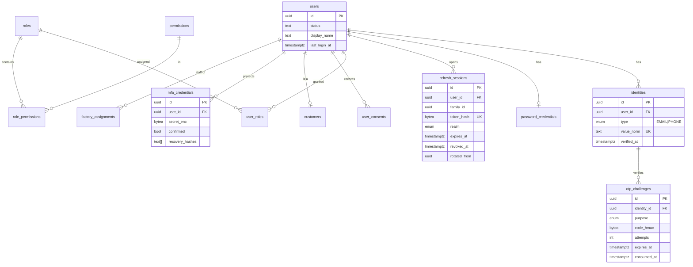
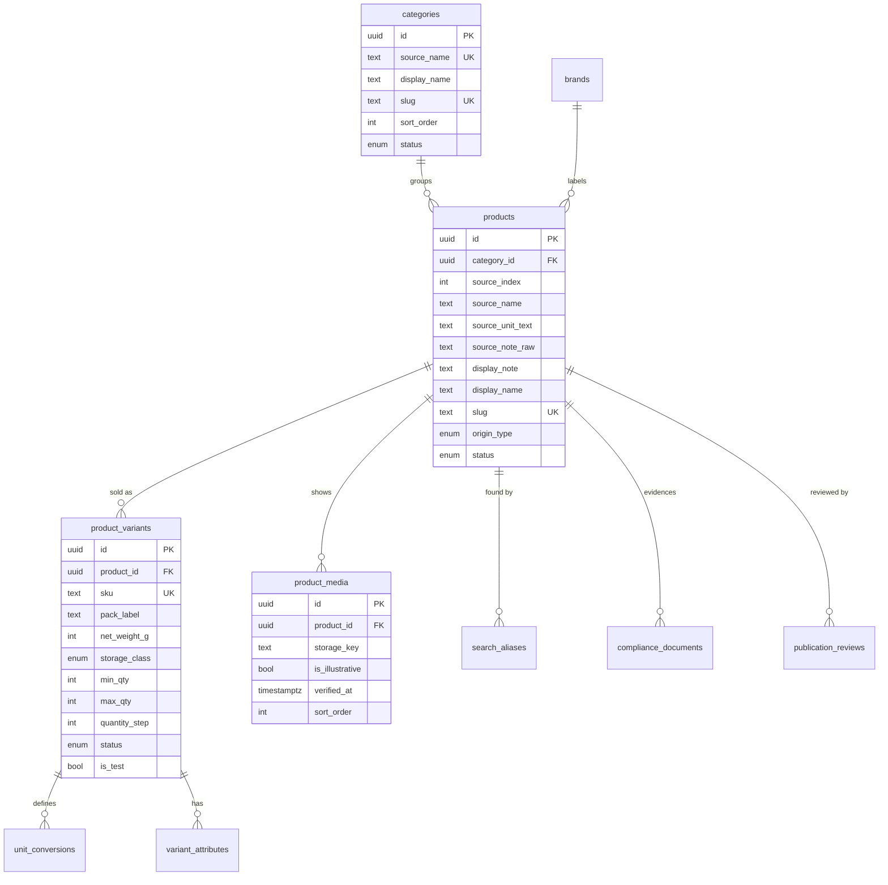
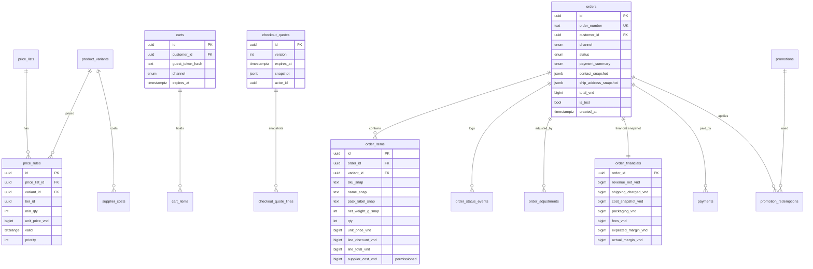
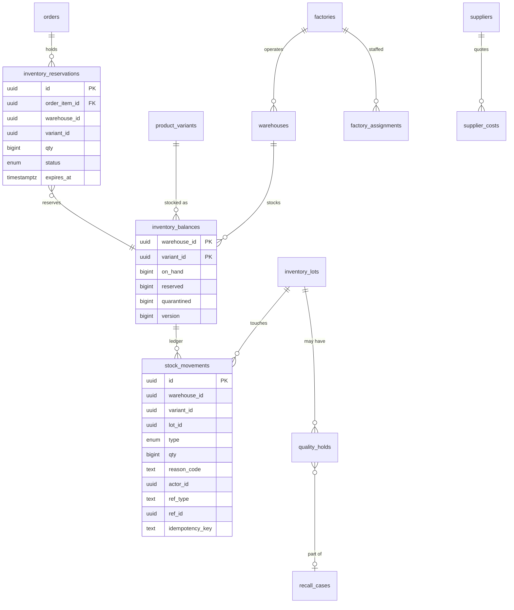
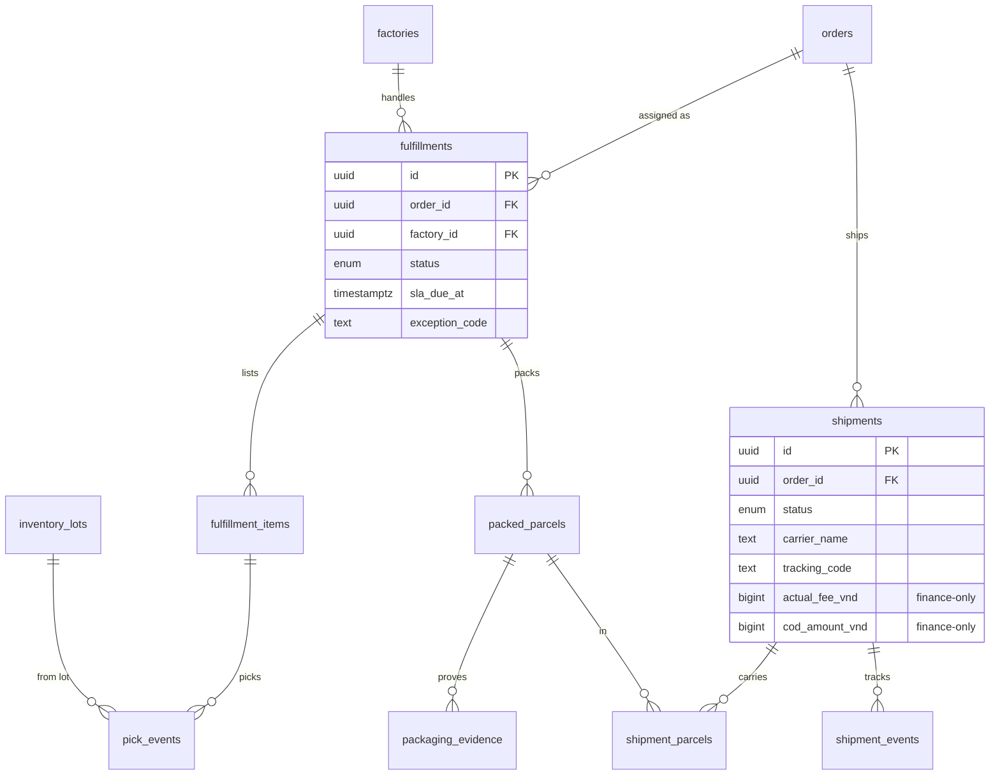

# BizGo — ERD and schema plan (Phase 0)

Conventions (ADR-0003/0006): UUIDv7 PKs · `*_vnd BIGINT` · weights in grams · `timestamptz` UTC · soft-delete via `deleted_at` only for non-financial entities · enums = PostgreSQL enums · every table has `created_at`, `updated_at` unless append-only (ledgers/events/audit).
Phase tag = the migration batch in which the table is first created (**tables are never created before the phase that uses them**).

## 1. Identity & access (Phase 1)

Tables: `users, identities, password_credentials, password_reset_tokens, otp_challenges, refresh_sessions, mfa_credentials, roles, permissions, role_permissions, user_roles, user_consents` (P1). `customers, addresses, organizations, organization_members, customer_tiers, wholesale_applications` — `customers/addresses` P1 (account), org/tier/applications P5.

## 2. Catalog (Phase 1 read-only seed; Phase 2 variants/pricing)

`categories, products, product_media, search_aliases` (P1). `product_variants, variant_attributes, unit_conversions, brands, compliance_documents, publication_reviews` (P2). `bundles, bundle_items, reviews` (P5, D18/D19).

## 3. Pricing & commerce (Phase 2)

`price_lists, price_rules, supplier_costs(alias of "factory_costs" in Arch), carts, cart_items, checkout_quotes, orders, order_items, order_status_events, order_financials, payments, payment_events, idempotency_keys, outbox_events, audit_logs, settings` (P2). `promotions, promotion_redemptions, order_adjustments` (P2/P3). `discount_approvals` (P4).

## 4. Inventory & supply (Phase 2 core, Phase 3 lots/quality)

`warehouses, inventory_balances, stock_movements, inventory_reservations, suppliers` (P2); `factories, factory_assignments, inventory_lots, quality_holds, recall_cases` (P3).

## 5. Fulfillment & shipping (Phase 3)

`fulfillments, fulfillment_items, pick_events, packed_parcels, packaging_evidence, shipments, shipment_parcels, shipment_events, notifications, email_jobs, file_objects` (P3); `carrier_quotes` (P5).

## 6. Money & after-sales (Phase 4)

`bank_transfer_verifications, refunds, receivables, cod_reconciliations, settlements, settlement_items, returns, return_items, complaints, support_tickets, support_messages, contact_requests, content_pages, banners, articles` (P4; `contact_requests/support_tickets` may land earlier with P2 because storefront forms need real endpoints). B2B (P5): `quotes, quote_items, invoices(only after D01/D14)`. Mobile (P6): `device_tokens`.

## 7. Key constraints & indexes (non-exhaustive, enforced in migrations)

- `products(slug)`, `product_variants(sku)`, `orders(order_number)`, `idempotency_keys(actor_scope, scope, key)`, `payment_events(provider, provider_event_id)` UNIQUE.
- `CHECK` on `inventory_balances` (ADR-0004); `CHECK` price ≥ 0, qty > 0; exclusion constraint on overlapping price windows.
- FKs `ON DELETE RESTRICT` for anything financial; no cascade to orders/ledgers.
- Indexes: `products(category_id,status)`, `orders(customer_id,created_at desc)`, `orders(status,created_at)`, `inventory_lots(variant_id,expires_at)`, `outbox_events(available_at) WHERE status='PENDING'`, `price_rules(variant_id, tier_id, valid)` GiST, `search_aliases(alias_norm gin_trgm_ops)`, `products(display_name gin_trgm_ops)`.
- Triggers: immutable `products.source_*`; append-only `stock_movements`, `*_status_events`, `audit_logs`, `payment_events`.
- DB roles: `bizgo_app` (read/write, no DDL), `bizgo_migrator`, `bizgo_factory_ro` (select on factory views only), `bizgo_audit_writer` (insert-only on `audit_logs`).

## 8. Migration strategy

1. **M001 (P1):** extensions (`pgcrypto`, `pg_trgm`, `unaccent`, `btree_gist`), enums, identity tables, categories/products/media/aliases, audit/outbox/idempotency/settings, DB roles & grants, triggers.
2. Prisma `schema.prisma` is the source for tables/enums; raw SQL migration steps (CHECKs, exclusion constraints, triggers, views, roles) live in the same migration folder (`migration.sql` edited after `prisma migrate dev --create-only`). Every such migration has a documented down/rollback note (forward-only in prod; rollback = restore-forward fix).
3. Seed is a separate idempotent program (`prisma/seed`), not a migration, so migrations stay environment-neutral.
4. CI test: migrate from empty DB → run seed twice (idempotent) → assert counts (82/8) → `prisma migrate diff` shows no drift.
