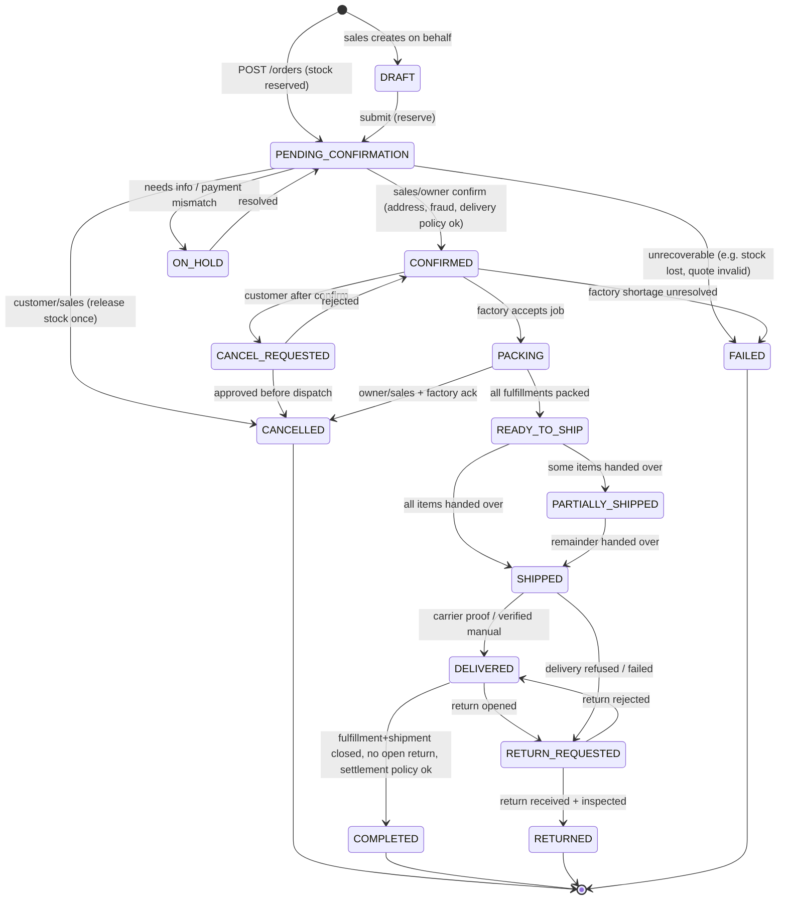
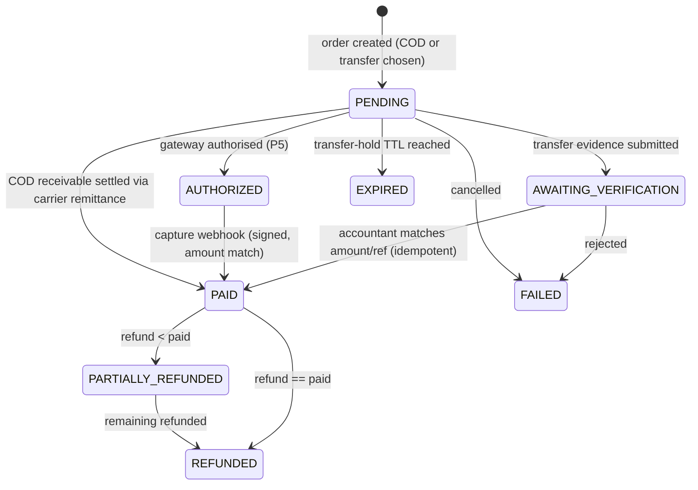
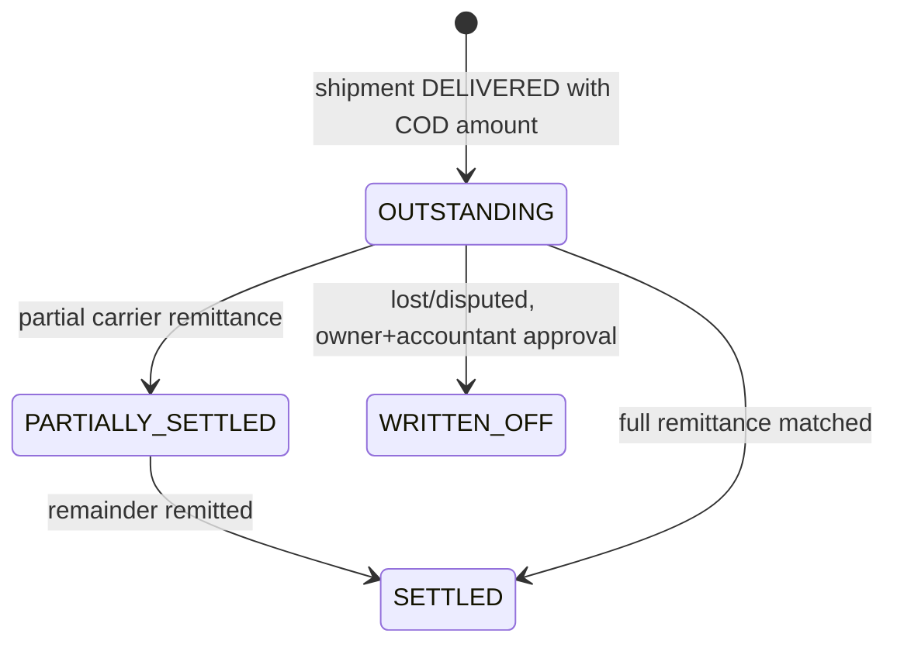
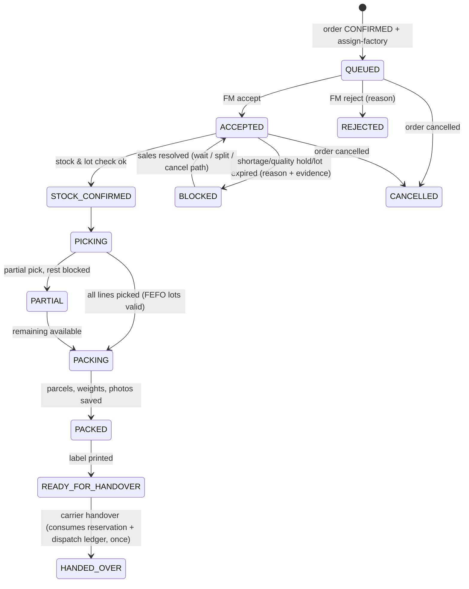
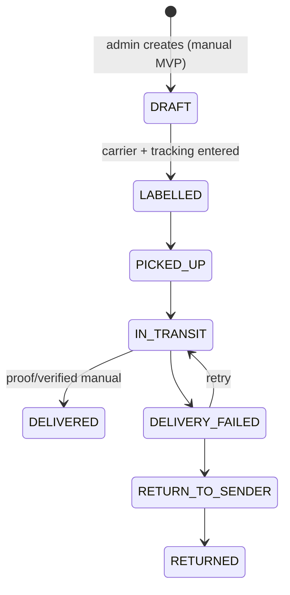
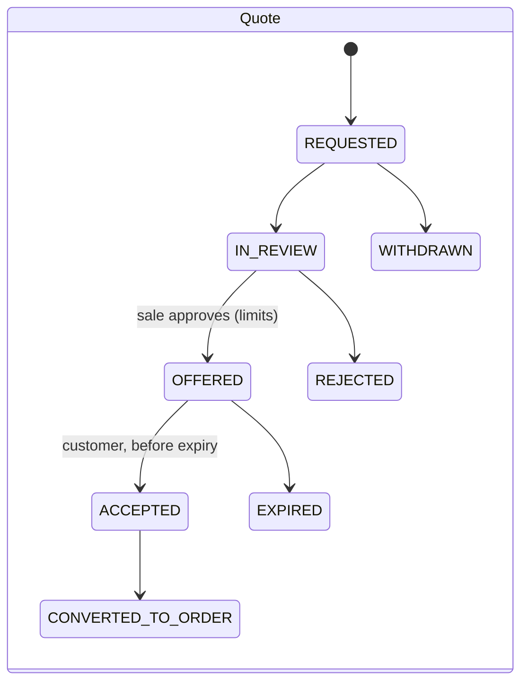
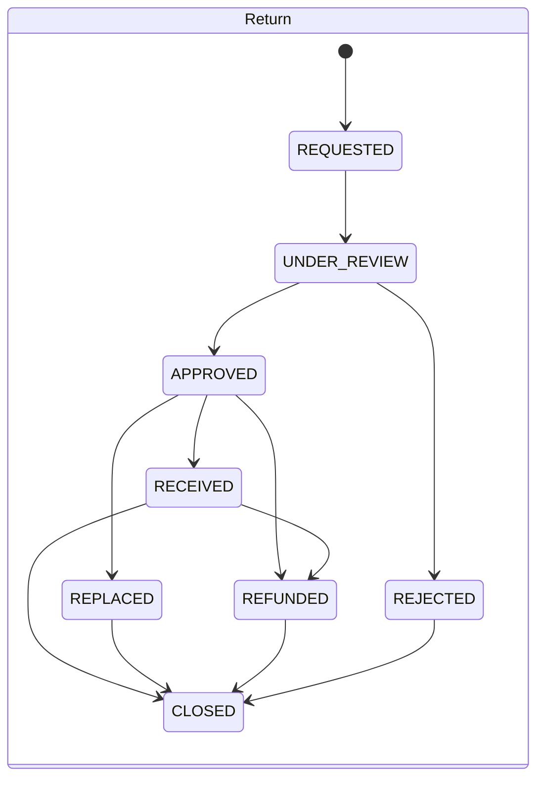
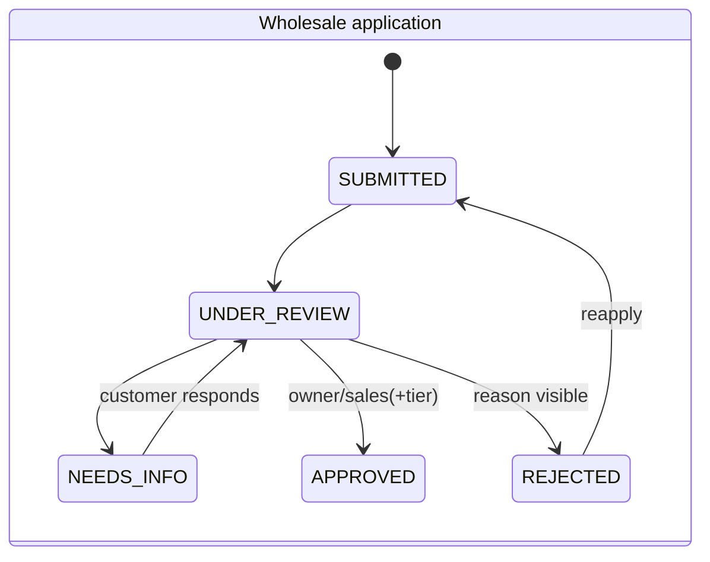

# BizGo — State machines and sequences

Canonical names and aggregation rules: ADR-0005. Every edge below = one `TransitionService` row with `(actor permission, guards, side effects)`; each emits status-event + audit + outbox in one transaction. Anything not drawn is **forbidden** (409 `INVALID_STATE_TRANSITION`).

## Order



After the first `HANDED_OVER`, `CANCELLED` is unreachable (only `RETURN_REQUESTED`).

## Payment



Wrong-amount webhook ⇒ event stored `QUARANTINED`, payment unchanged, alert raised. Duplicate provider event id ⇒ ignored (unique key).

## COD receivable



## Fulfillment (factory job)



Factory never swaps SKU; shortage ⇒ `BLOCKED` ⇒ sales presents customer choices (wait / substitute with explicit acceptance / split shipment / cancel+refund). Price changes need customer acknowledgement.

## Shipment



## Reservation

`HELD → CONSUMED` (dispatch) · `HELD → RELEASED` (cancel) · `HELD → EXPIRED` (transfer TTL). Terminal states immutable; each change guarded by `WHERE status='HELD'` (rowCount = 1).

## Quote (B2B), Return, Wholesale application, Settlement







Settlement: `OPEN → RECONCILING → APPROVED → PAID`, `RECONCILING|APPROVED → DISPUTED → RECONCILING`. Restock after return only from `RECEIVED` after quality inspection.

## Sequence — checkout → order → fulfillment → cash (FLOW A)

```mermaid
sequenceDiagram
  autonumber
  participant C as Customer web
  participant API as API (Checkout/Orders)
  participant DB as PostgreSQL
  participant W as Worker
  participant S as Sales (admin)
  participant F as Factory
  C->>API: POST /checkout/quote {items, address}
  API->>DB: price + availability + eligibility (read)
  API-->>C: quote{id,version,expiresAt,blockers[]}
  C->>API: POST /orders (Idempotency-Key, quoteId, version)
  API->>DB: BEGIN; idempotency insert; re-price; reserve (conditional UPDATE per variant ASC)
  API->>DB: insert order+items+financials+payment(PENDING)+events+outbox; COMMIT
  API-->>C: 201 {orderNumber, PENDING_CONFIRMATION}
  W->>DB: poll outbox (SKIP LOCKED) -> notify BizGo
  S->>API: POST /admin/orders/:id/confirm, /assign-factory
  F->>API: accept -> stock-confirm -> pick (FEFO) -> pack(+evidence) -> handover
  API->>DB: HANDED_OVER: reservation CONSUMED, on_hand--, ledger DISPATCH (once)
  S->>API: POST /admin/shipments {carrier, tracking} (manual)
  S->>API: mark DELIVERED -> receivable OUTSTANDING (COD)
  S->>API: COD reconciliation -> receivable SETTLED -> payment PAID
  API->>DB: settlement + actual margin (expected snapshot unchanged)
```
